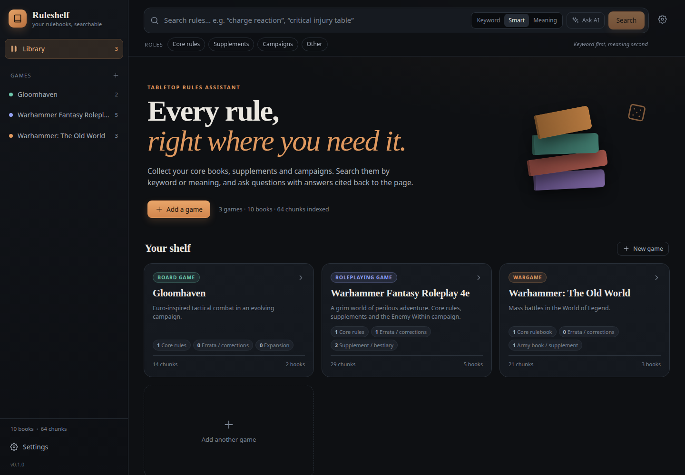
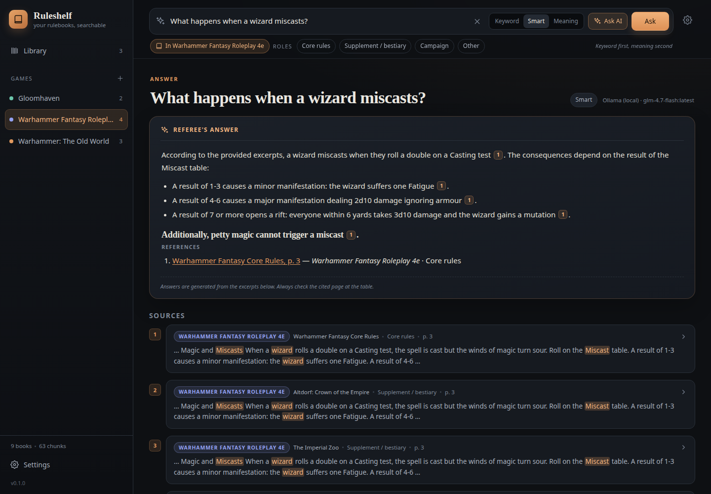
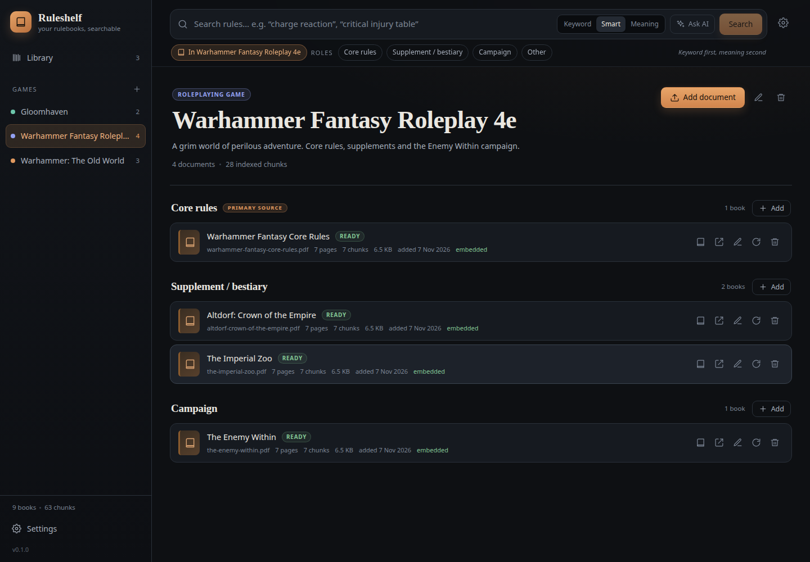

# Ruleshelf

**Every rule, right where you need it.** Ruleshelf is a self-hosted library and search engine for
tabletop rulebooks — roleplaying games, board games and wargames. Search by keyword or by meaning,
or ask a question and get an answer with citations back to the exact page.

```bash
docker compose up -d      # then open http://localhost:8080
```



## What it does

- **One shelf per game.** Each game has a typed structure: a core rule set (the primary source),
  supplements/expansions (bestiaries, army books) and campaigns (separate from the rules).
- **Uploads stay yours.** PDFs, EPUB, DOCX, Markdown, text and HTML are stored on disk and indexed
  into a local SQLite database. Nothing leaves your machine unless you call an AI provider.
- **Errata wins.** File official corrections under **Errata**: they are boosted above the core rules
  in every search mode, flagged with an "overrides core rules" badge, and the AI is instructed to
  treat them as superseding where the texts conflict. Every answer says when errata took precedence.
- **Three search modes.**
  - *Keyword* — SQLite FTS5, exact words, names and table entries.
  - *Meaning* — vector search over your embedding model.
  - *Smart* — hybrid keyword + vector ranking (reciprocal rank fusion).
- **Answer-first search.** Every search returns a cited answer above the results, not just a list
  of pages. Questions are expanded into rulebook vocabulary first (so "how fast can a dwarf run"
  finds the Movement table), and answers show their arithmetic and sources. Turn the **Answer**
  toggle off for results-only search.
- **Grounded answers.** Citations link straight into the reader; every answer ends with a
  References block listing the document, page and a link to the source.
- **Reader built in.** Open any result in a drawer, read the page, jump to the original PDF at that
  page, or download the file.
- **Cover view.** Generated thumbnails from PDF/EPUB covers (and typographic cards for other
  formats) in a cover grid with actions overlaid on each book, or a compact list with small covers.
- **Light and dark themes.** A warm paper light theme and the original dark theme, with a toggle in
  the sidebar (and top bar). The choice is remembered per browser and follows the system theme on
  first visit.
- **Optional BGG forums.** Enable *BGG forums* before asking to add BoardGameGeek thread snippets
  from a web search. Forum results are highlighted as unofficial, while rulebook excerpts are always
  authoritative and ranked first. No BGG API token is required: only the question and game title go to
  the search engine, and only public thread snippets are used.
- **Bring your own model.** Built-in support for **Ollama** (free/local), **OpenAI/ChatGPT**,
  **Anthropic Claude**, **DeepSeek** and **Qwen/DashScope**, plus any OpenAI-compatible endpoint
  (OpenRouter, LM Studio, vLLM, LiteLLM, Azure gateways…). Adding another API dialect is one file.
- **Choose the model per question.** The search bar lists every chat model reported by your enabled
  providers; pick one before asking. Answers show the exact answer model and embedding model used.
- **Campaigns with scenarios.** Create a campaign group (for example *The Enemy Within*) and file
  each scenario/book under it. Scenarios can be reordered and moved between campaigns without
  re-uploading; each campaign can be collapsed in the view.
- **Data-driven game types.** Built-in RPG / board game / wargame types, and custom types with
  custom roles can be added in Settings.
- **One container, one volume.** ~180 MB compressed, multi-arch (`amd64` and `arm64`).



## Quick start

The published image lives at `ghcr.io/eciurleo/ruleshelf`.

```bash
# with the compose file from this repo
docker compose up -d
# or plain Docker
docker run -d --name ruleshelf \
  -p 8080:8000 \
  -v ruleshelf-data:/data \
  --add-host=host.docker.internal:host-gateway \
  ghcr.io/eciurleo/ruleshelf:latest
```

Open <http://localhost:8080>. Add a game, upload its core rulebook, and start searching.

To upgrade:

```bash
docker compose pull && docker compose up -d
```

To build the image yourself instead of pulling:

```bash
docker compose -f compose.dev.yml up -d --build
```

## Install on your own server

Ruleshelf is a single container and works on Unraid, Synology, a VPS or any Docker host. The only
required mount is a writable folder for the database and uploaded files.

### 1. Choose a data folder

Use one folder per app and keep it on persistent storage:

```
/srv/ruleshelf/            # or /mnt/user/Data/ruleshelf on Unraid
└── data/                  # mounted to /data
    ├── ruleshelf.db       # library, index, embeddings
    ├── config.json        # settings, AI providers and custom game types (mode 0600)
    ├── files/             # uploaded PDFs/EPUB/DOCX, untouched
    └── thumbnails/        # generated cover JPEGs (safe to delete)
```

The container creates `data/files/` and `data/config.json` on first start. Back up this whole
folder.

`config.json` is written atomically after every settings/provider change and is **re-applied on
startup**, so it is the source of truth for configuration. Edit it (then restart the container) or
restore it alongside the data folder to recover the exact configuration. It contains API keys and is
created with mode `0600`.

### 2. Pick a free port

The container listens on **8000**; map it to any free host port. Before choosing, check:

```bash
ss -ltn | grep ':8787 ' || echo "8787 is free"
# or, on Unraid
docker ps --format '{{.Names}}\t{{.Ports}}' | grep 8787 || true
```

### 3. Run it

```bash
docker run -d --name Ruleshelf \
  --restart unless-stopped \
  -p 8787:8000 \
  -v /srv/ruleshelf/data:/data \
  -e PUID=1000 -e PGID=1000 \
  -e RULESHELF_OLLAMA_URL=http://host.docker.internal:11434 \
  --add-host=host.docker.internal:host-gateway \
  ghcr.io/eciurleo/ruleshelf:latest
```

- `PUID`/`PGID` control who owns `/data`. Use your own user's ids (`id -u`, `id -g`); on Unraid use
  `99` and `100` (`nobody:users`) so the folder is accessible over SMB. The container chowns
  `/data` on start and then drops root.
- `--add-host` is only needed to reach Ollama running on the Docker host.
- Drop the port/volume flags if you use the compose file below.

Or use Compose:

```yaml
services:
  ruleshelf:
    image: ghcr.io/eciurleo/ruleshelf:latest
    container_name: Ruleshelf
    ports:
      - "8787:8000"
    volumes:
      - /srv/ruleshelf/data:/data
    environment:
      PUID: "1000"
      PGID: "1000"
      RULESHELF_OLLAMA_URL: http://host.docker.internal:11434
    extra_hosts:
      - "host.docker.internal:host-gateway"
    restart: unless-stopped
```

Upgrade by pulling the new image and recreating the container; the volume is untouched:

```bash
docker pull ghcr.io/eciurleo/ruleshelf:latest
docker rm -f Ruleshelf   # then re-run the command above, or `docker compose up -d`
```

### Unraid

A ready-made template is in [`deploy/unraid/ruleshelf.xml`](deploy/unraid/ruleshelf.xml):

```
/mnt/user/Data/ruleshelf/
└── data/                 # /data in the container
```

The template uses port **8787**, `PUID=99`, `PGID=100` and mounts
`/mnt/user/Data/ruleshelf/data`. Import it via **Docker → Add Container → Template**, or copy it
to `/boot/config/plugins/dockerMan/templates-user/`. There is also
[`deploy/unraid/docker-compose.yml`](deploy/unraid/docker-compose.yml) for the Compose Manager
plugin. Check the port is free first — Unraid commonly uses 8080 (Immich), 3001, 8085 and 9696.

## Setting up AI

Keyword search works with no configuration at all. Meaning search and *Ask AI* need a provider.

**Option A — local and free (Ollama)**

The repo ships a ready-made stack with Ruleshelf + Ollama:

```bash
docker compose -f docker-compose.ollama.yml up -d
docker compose -f docker-compose.ollama.yml exec ollama ollama pull nomic-embed-text
docker compose -f docker-compose.ollama.yml exec ollama ollama pull qwen2.5:14b-instruct-q4_K_M
# optional faster model:
docker compose -f docker-compose.ollama.yml exec ollama ollama pull llama3.1:8b-instruct-q4_K_M
```

Open <http://localhost:8787>. Ruleshelf reaches Ollama at `http://ollama:11434` inside the compose
network and the default model is selected in **Settings → Search & answers**. Change the host port
if 8787 is taken; both the app and model data live in named volumes.

To run Ollama separately instead (or install it natively):

```bash
docker run -d --name Ollama --restart unless-stopped \
  -p 11434:11434 \
  -v /mnt/user/Data/ollama:/root/.ollama \
  ollama/ollama:latest

docker exec Ollama ollama pull nomic-embed-text
docker exec Ollama ollama pull llama3.1:8b-instruct-q4_K_M
# optional, slower but better on tricky rules:
docker exec Ollama ollama pull qwen2.5:14b-instruct-q4_K_M
```

In Ruleshelf: **Settings → AI providers → Ollama**, set the base URL, chat model and embedding
model, **Save**, then **Load models → Test**. For the compose setup the URL is already
`http://host.docker.internal:11434`. If Ollama runs on another machine, point the URL there.

**Which local model?** Ruleshelf sends several long excerpts, so models need enough context (the
Ollama driver requests 8192 tokens). Measured on an 8-core Ryzen 7 5825U with **no GPU**:

| Model | Download | RAM | Typical answer |
| --- | --- | --- | --- |
| `nomic-embed-text` | 274 MB | ~1 GB | embeddings, under a second |
| `llama3.1:8b-instruct-q4_K_M` | 4.9 GB | ~6 GB | 15–35 s |
| `qwen2.5:14b-instruct-q4_K_M` | 9.0 GB | ~11 GB | 60–90 s |

The **14B model is the best local choice**: it correctly treated errata as replacing the
superseded core rule in testing. The 8B is roughly twice as fast but occasionally mixed old core
rows into errata answers. A 7B model was faster still but unreliable on precedence. If you have no
spare RAM, run the 8B, or point Ruleshelf at a hosted provider instead.

For comparison, the same "how fast can a dwarf run" question on a WFRP 4e library took **~2–3
minutes** locally with Qwen2.5 14B and **~4 seconds** with hosted DeepSeek `deepseek-chat`. Hosted
models send the retrieved excerpts to the provider; Ollama keeps everything on your server.

Ollama's default context window is 2048 tokens, which truncates RAG prompts. Ruleshelf requests
8192 per chat request, and keeps the model loaded for 30 minutes.

**Option B — hosted**

Add your own key for OpenAI, Anthropic, DeepSeek or Qwen in the same screen. Then in
**Settings → Search & answers**, choose the default chat provider/model and the embedding
provider/model. Claude has no embedding model; pair it with Ollama or OpenAI for vectors.

After choosing an embedding model for an existing library, run **Build embeddings** with
*Re-embed everything* ticked. New documents embed automatically.

> API keys are written to the local SQLite database inside the volume. They are never returned by
> the API in plain text and never sent anywhere except the provider you configured.

## How the library is organised

| Level | Examples |
| --- | --- |
| Game | *Warhammer Fantasy Roleplay 4e* — type: RPG |
| └ Core rules | *Warhammer Fantasy Core Rules* — the primary source |
| └ Errata | *Core Rules Errata v1.2* — corrections that override the core rules |
| └ Supplements | *The Imperial Zoo*, *Altdorf: Crown of the Empire* |
| └ Campaigns | *The Enemy Within* |
| Game | *Warhammer: The Old World* — type: Wargame |
| └ Core rules | *Core Rulebook* |
| └ Army books | *Arcane Journal: Kingdom of Bretonnia* |

Roles are per game type and can be changed (or new types added) in **Settings → Game types**.
A role can carry a `precedence` value; errata ships with `100`, which boosts it above normal rules
and marks its results as overriding.

Campaigns are groups inside the campaign role. In a game, open **Campaigns → New campaign**, name it
(e.g. *The Enemy Within*), then use **Add scenario** to upload each book into it. Set the scenario
order number on each book to control its position, and use **Hide/Show scenarios** to collapse a
campaign. Existing campaign documents appear under *Ungrouped campaign documents*; use the campaign
menu on each book to move them into a group. Deleting a campaign keeps its documents and ungroups
them.



## Search tips

- `"exact phrase"` searches a phrase; other words are AND-ed and the last word is prefix-matched.
- Filter by role (core / errata / supplements / campaigns) to keep campaign spoilers out of rules answers.
- Errata is prioritised over the core rules automatically; add precedence to any custom role in
  **Settings → Game types** if your game uses a different source of corrections.
- *Meaning* search finds “wizard spell goes wrong” even when the book says “miscast”.
- The reader shows the indexed page; the **Original** button opens the PDF at that page.

## Supported files

| Format | Notes |
| --- | --- |
| `.pdf` | Needs a text layer. Scanned books must be OCR'd first (`ocrmypdf in.pdf out.pdf`). |
| `.epub` | One citable unit per chapter. |
| `.docx` | Grouped by heading. |
| `.txt`, `.md`, `.rst` | A form feed (`\f`) starts a new page. |
| `.html`, `.htm` | Readable text is extracted. |

Maximum upload size is 512 MB per file (`RULESHELF_MAX_UPLOAD_MB` to change it).

## Data, backup and privacy

Everything lives in the mounted volume (`/data` by default):

```
/data/ruleshelf.db   SQLite: library, FTS index, embeddings
/data/config.json    settings, provider keys, custom game types (authoritative on startup)
/data/files/         your uploaded documents, untouched
/data/thumbnails/    generated cover images; rebuilt on demand if deleted
```

Back up by copying the volume, or:

```bash
# named volume
docker run --rm -v ruleshelf-data:/data -v "$PWD":/backup alpine \
  tar czf /backup/ruleshelf-backup.tgz -C /data .

# bind mount (Unraid or /srv layouts)
tar czf ruleshelf-backup.tgz -C /mnt/user/Data/ruleshelf data
```

Ruleshelf has no accounts and no outbound telemetry. Bind it to `127.0.0.1` (or put it behind your
own reverse proxy) if the machine is shared — anyone who can reach the port can use the library.

## Configuration

| Environment variable | Default | Purpose |
| --- | --- | --- |
| `RULESHELF_DATA_DIR` | `/data` in the image | Database and uploaded files. |
| `PUID` / `PGID` | `1000` / `1000` | Owner of `/data`; the container drops to this uid/gid. Unraid: `99`/`100`. |
| `RULESHELF_OLLAMA_URL` | `http://host.docker.internal:11434` in Docker | Default Ollama address seeded for new installs. |
| `RULESHELF_MAX_UPLOAD_MB` | `512` | Per-file upload limit. |
| `RULESHELF_CHUNK_SIZE` / `..._OVERLAP` | `1100` / `160` | Indexing window. Re-index documents after changing. |
| `RULESHELF_HOST` / `..._PORT` | `0.0.0.0` / `8000` | Only for `python -m app`. |

## Development

Requirements: Python 3.12, Node 22.

```bash
# backend
cd backend
python -m venv .venv && source .venv/bin/activate
pip install -r requirements-dev.txt
uvicorn app.main:app --reload          # http://localhost:8000, data in ./backend/data

# frontend (second terminal)
cd frontend
npm install
npm run dev                            # http://localhost:5173, proxies /api
```

```bash
cd backend && pytest -q && ruff check app tests
cd frontend && npm run build
```

The API is documented at <http://localhost:8000/docs>.

### Project layout

```
backend/app/
  api/           HTTP routers: games, documents, search/ask, providers, settings
  services/      ingestion, chunking, retrieval, embeddings, RAG, background jobs
  providers/     AI drivers + auto-discovered registry
  extractors/    file-format drivers + auto-discovered registry
  db.py          schema, migrations, seed data
frontend/src/
  components/    UI: library, game view, search, reader, settings
  lib/api.ts     typed API client and SSE streaming
Dockerfile       multi-stage: Vite build + FastAPI runtime
```

### Extending it

**A new AI provider type** (if it is not OpenAI-compatible):

```python
# backend/app/providers/my_api.py
from app.providers.base import ModelInfo, Provider
from app.providers import register_driver

class MyProvider(Provider):
    kind = "my_api"

    def list_models(self):
        return [ModelInfo(id="my-model")]

    def chat(self, messages, model, temperature=0.2, max_tokens=2048):
        yield "..."  # stream text chunks

register_driver("my_api", "My API", "What it is", cls=MyProvider)
```

Restart: the type appears in **Settings → Add provider**. Endpoints that speak the OpenAI shape need
no code — add them as a `openai_compat` custom provider.

**A new file format:**

```python
# backend/app/extractors/rtf.py
from app.extractors.base import ExtractedPage
from app.extractors.registration import register_extractor

def extract_rtf(path: str) -> list[ExtractedPage]:
    return [ExtractedPage(number=1, text=open(path).read())]

register_extractor(["rtf"], "Rich Text", extract_rtf)
```

**A new game type / role:** use **Settings → Game types**, no restart needed.

Other extension points: `services/chunking.py` (splitting), `services/search.py` (ranking),
`services/rag.py` (prompting), or add a new router in `app/api/`.

## Security and dependency updates

- **Container scan:** every push, pull request and weekly schedule builds the image and scans it
  with Trivy (HIGH/CRITICAL, fixed findings only). Results are uploaded to
  **Security → Code scanning** and kept as a workflow artifact.
- **Dependabot:** weekly updates for npm, pip, GitHub Actions and the Docker base image. Patch and
  minor updates auto-merge after CI and the security scan pass; **major updates are left for manual
  review**. Auto-merge is a workflow using `pull_request_target`; it never checks out or runs PR code.

## Troubleshooting

- **“Ollama unreachable” from Docker.** Use `http://host.docker.internal:11434`, keep
  `extra_hosts: host.docker.internal:host-gateway` (already in the compose file), and make sure
  Ollama listens on all interfaces (`OLLAMA_HOST=0.0.0.0`).
- **PDF indexed 0 pages.** It is a scan without a text layer; OCR it first.
- **Changed the embedding model and search feels wrong.** Settings → Search & answers →
  *Re-embed everything*.
- **Permission denied on a bind mount.** The container runs as UID 1000; `chown -R 1000:1000` the
  host folder, or use the named volume (recommended).

## License

MIT — see [LICENSE](LICENSE). Contributions are welcome; see [CONTRIBUTING.md](CONTRIBUTING.md).
